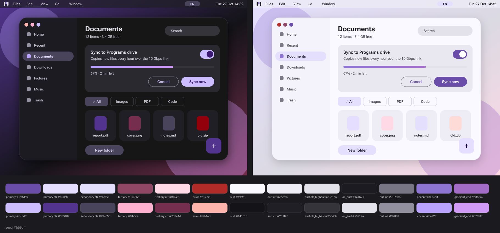

# MatOS

macOS 26's look rebuilt in Material You. A theme for KDE Plasma 6 (Wayland) and the apps around it: soft rounded windows, a lavender-to-orchid accent that follows your system accent, Roboto Flex, glass shadows, and a pill-letter icon for every app.

Everything is generated from one palette (`tools/palette.py`), so changing the accent regenerates every layer.



## What's in it

| Part | Where |
|---|---|
| Colour schemes, Plasma style, Kvantum, window decoration (Aurorae), rounded-corner KWin settings, icon theme, wallpaper, launcher icon | `install.sh` |
| Firefox skin | `firefox/install.sh` |
| Ghostty themes + config | `ghostty/install.sh` |
| Logos and per-app icons | `brand/logo/` (regenerate with `Scripts for Claude/build_logo.py`) |

## Install (Arch / CachyOS, Plasma 6 on Wayland)

```bash
sudo pacman -S kvantum kwin-effect-rounded-corners librsvg python-pillow python-fonttools
git clone https://github.com/Obscuratea/matos && cd matos
./install.sh              # build + install, nothing switches yet
./install.sh --apply      # switch to MatOS Dark (or: --apply light); your old settings are backed up
./install.sh --seed '#ff8a5c' --apply   # use a specific accent instead of your KDE accent
./restore.sh              # go back
```

Then, optionally, `./firefox/install.sh` and `./ghostty/install.sh`. Firefox needs a restart.

Scripts never use sudo. Apps that were open keep their old look until restarted.

## Licence

Code: MIT. Roboto Flex (`fonts/`) is under the SIL Open Font License.
